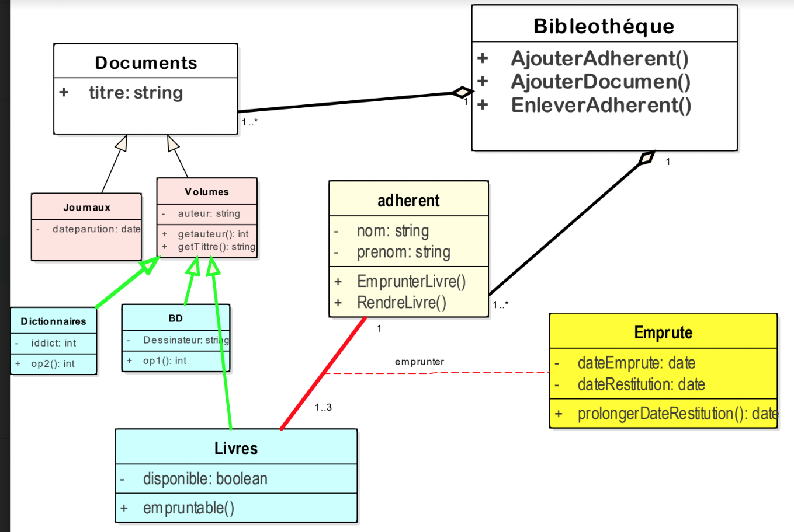
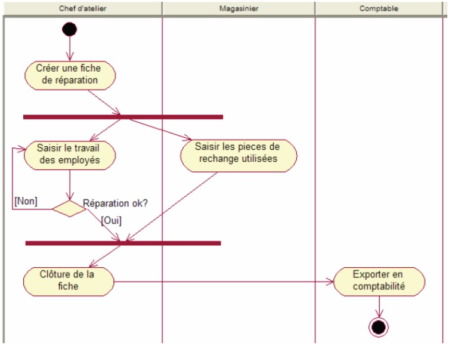

# Travaux académiques en informatique — Ali Tayebi

**Conception orientée objet • Java • UML • Structures de données**

Ce dépôt rassemble une sélection de travaux réalisés dans le cadre de mon parcours universitaire en informatique fondamentale à l’Université Ibn Tofaïl (Kénitra). Il accompagne mes candidatures en master informatique, notamment en génie logiciel.

> **Nature du travail :** exercices et travaux pratiques académiques. Ils illustrent des concepts étudiés en cours ; ils ne sont pas présentés comme des applications professionnelles déployées. Le code est partagé à titre de démonstration pédagogique.

## Aperçu des compétences et preuves dans le code

| Compétence | Exemple vérifiable | Ce que montre le fichier |
|---|---|---|
| **Classes abstraites et héritage** | [`Application.java`](Java/TP5/src/ex1/Application.java) et [`WebApplication.java`](Java/TP5/src/ex1/WebApplication.java) | Déclaration d’une classe abstraite, sous-classe et méthode redéfinie `getPlatform()` |
| **Polymorphisme** | [`ApplicationManager.java`](Java/TP5/src/ex1/ApplicationManager.java) | Collection d’objets `Application` représentant différents types d’applications ; usage de `instanceof` |
| **Collections et filtrage** | [`ApplicationManager.java`](Java/TP5/src/ex1/ApplicationManager.java) | `LinkedList`, `Predicate`, filtrage et regroupement par framework |
| **Exceptions personnalisées** | [`DuplicateApplicationException.java`](Java/TP5/src/ex1/DuplicateApplicationException.java) | Création d’une exception pour les doublons et déclenchement lors de l’ajout |
| **Streams et lambda** | [`ParcAuto.java`](Java/TP5/src/ex2/ParcAuto.java) | Filtres, agrégations et calcul de la capacité totale des camions |
| **Structures de données** | [`Pile.java`](Java/TP3/src/com/ex1/Pile.java) | Manipulation d’une pile et gestion des cas limites |
| **Programmation objet appliquée** | [`Bibliotheque.java`](Java/TP2/src/ex1/Bibliotheque.java) | Gestion de livres et d’étagères, ajout et recherche |

### Exemple 1 — Classe abstraite et héritage

Extrait de [`Java/TP5/src/ex1/Application.java`](Java/TP5/src/ex1/Application.java) :

```java
public abstract class Application {
    // ... attributs et constructeur ...
    public abstract String getPlatform();
}
```

La sous-classe [`WebApplication`](Java/TP5/src/ex1/WebApplication.java) fournit une implémentation de `getPlatform()` qui retourne `"web"`.

### Exemple 2 — Exceptions et collections

[`ApplicationManager.java`](Java/TP5/src/ex1/ApplicationManager.java) montre une collection de types d'applications et l'utilisation de `DuplicateApplicationException` pour empêcher l'ajout d'un doublon.

### Exemple 3 — Streams Java

Extrait de [`Java/TP5/src/ex2/ParcAuto.java`](Java/TP5/src/ex2/ParcAuto.java) :

```java
public double getTotalCapacite2() {
    return mapVehicule.values().stream()
            .filter(v -> v instanceof Camion)
            .map(v -> (Camion) v)
            .filter(c -> c.getType() == TypeCamion.TONNE)
            .mapToDouble(v -> v.getCapacite())
            .sum();
}
```

## Travaux pratiques Java

| Dossier | Contenu |
|---|---|
| [`TP1`](Java/TP1/src) | Classes, objets, exercices sur les comptes bancaires, la calculatrice, les dates et les chaînes |
| [`TP2`](Java/TP2/src) | Bibliothèque, étudiants, véhicules, tâches et collections |
| [`TP3`](Java/TP3/src) | Exceptions personnalisées, pile, filtrage, lambda et commandes |
| [`TP4`](Java/TP4/src) | Collections et traitement de stocks |
| [`TP5`](Java/TP5/src) | Gestion d'applications Web/mobile/bureau et gestion d'un parc automobile |

## Modélisation UML

Ces diagrammes sont issus d'exercices de conception orientée objet et montrent la pratique de différentes vues statiques et dynamiques.

| Classes | Cas d'utilisation | Activités / États |
|---|---|---|
| [Bibliothèque](UML/01_classes_bibliotheque.png) | [Réservation des salles](UML/04_cas_utilisation_reservation_salles.png) | [Contrôle d'accès](UML/07_etats_transitions_controle_acces.png) |
| [Établissement scolaire](UML/02_classes_etablissement_scolaire.png) | [Vente en magasin](UML/05_cas_utilisation_vente_magasin.png) | [Processus de réparation](UML/08_activite_reparation_auto.png) |
| [Structure d'un document](UML/03_classes_structure_document.png) | [Distributeur de billets](UML/06_cas_utilisation_distributeur.png) | [Création d'une fiche de réparation](UML/09_activite_fiche_reparation.png) |

**Quelques exemples :**





## Compilation et exemples d'exécution

Les fichiers `.java` des cinq TP ont été compilés séparément avec **OpenJDK 21** lors de la préparation de ce dépôt. La compilation valide la syntaxe, mais ne constitue **pas** une vérification exhaustive de toutes les fonctionnalités. Les exercices n’ont pas tous une classe `Main` exécutable.

Exemple pour compiler et exécuter le projet de bibliothèque (Linux / macOS, depuis la racine du dépôt) :

```bash
mkdir -p build/TP2
javac -encoding UTF-8 -d build/TP2 $(find Java/TP2/src -name '*.java')
java -cp build/TP2 ex1.Main
```

Pour tester le filtrage de produits du TP3 :

```bash
mkdir -p build/TP3
javac -encoding UTF-8 -d build/TP3 $(find Java/TP3/src -name '*.java')
java -cp build/TP3 com.ex4.Main
```

## À propos

Auteur des travaux académiques : **Ali Tayebi**. Ces réalisations illustrent mon intérêt pour la programmation orientée objet, la modélisation logicielle et le développement d'applications.

**Note de transparence :** les sources sont conservées proches de leurs versions de TP ; certains exercices peuvent contenir des simplifications, des fonctionnalités non couvertes par des tests automatisés ou des points d'amélioration. Les diagrammes UML ont été réalisés en contexte pédagogique et peuvent être perfectionnés.
